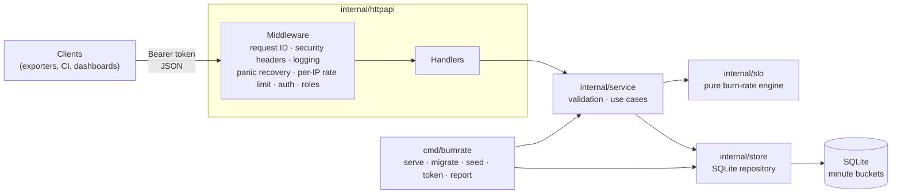

# burnrate

**Know your SLO error budget is burning before your customers do.**

[](https://github.com/Mbarney928/burnrate/actions/workflows/ci.yml)
[](LICENSE)


burnrate is a small, self-hosted service that tracks Service Level Objectives (SLOs). You
register services and their objectives ("99.9% of checkout requests succeed over 30 days"),
report good/total event counts, and burnrate tells you how much error budget is left, how fast
it is burning, whether that deserves a page or a ticket, and when the budget will run out.

## The business problem

Small platform and SRE teams usually find out they've blown a reliability target after a
customer escalation, or from a monthly report that arrives too late to act on. Threshold
alerts on raw error rates make it worse: they page at 3 a.m. for blips that barely touch the
budget, and stay silent during slow leaks that quietly burn a month's budget in a week.

burnrate gives those teams the alerting model from the Google SRE Workbook without needing a
full observability stack. **The metric it moves is time-to-detect for SLO-threatening
incidents**, while cutting noisy pages that don't threaten the objective.

## Features

- **Error-budget accounting**: SLI, budget consumed and remaining over a rolling window (1–90 days).
- **Multi-window, multi-burn-rate alerts**: page on fast burns (2% of budget in 1h, 5% in 6h),
  ticket on slow burns (10% in 3d). A short window must confirm each alert, so pages stop as soon
  as an incident is fixed.
- **Window-aware thresholds**: thresholds are derived from the share of budget spent, so a 7-day
  SLO gets correctly scaled thresholds rather than the 30-day constants.
- **Exhaustion forecast**: a linear projection of when the remaining budget runs out at the
  current 6h burn rate.
- **Point-in-time queries**: `?at=` evaluates any SLO as of a past instant (useful for postmortems).
- **Urgency-sorted overview**: pages first, then tickets, then least budget remaining.
- **Role-based API tokens**: `viewer` reads, `editor` writes; tokens are stored only as hashes.
- **CLI**: `serve`, `migrate`, `seed`, `token create` and a terminal `report`.
- **OpenAPI 3.1 spec** served at `/openapi.yaml`.

## Demo

```console
$ burnrate seed
Seeded 4 fictional services with 30 days of synthetic traffic ending 2026-11-06T17:34:48Z:
  checkout-api           healthy: steady 0.3x burn, plenty of budget left
  search-api             active incident: 20x burn for the last 50 minutes, fast-burn page
  notifications-worker   slow leak: 1.5x burn for two days, slow-burn ticket with an exhaustion forecast
  billing-api            exhausted: a six-hour outage ten days ago used more than the whole budget

Demo API tokens (shown once, stored only as hashes):
  editor: brt_…
  viewer: brt_…

$ burnrate report
SERVICE               SLO                  TARGET  SLI      BUDGET LEFT  BURN 1h  BURN 6h  BURN 3d  SEVERITY  EXHAUSTS IN
search-api            latency-under-300ms  99.5%   99.834%  66.8%        16.32    2.93     0.62     PAGE      6.8d
notifications-worker  delivery             99%     99.619%  61.9%        1.50     1.51     1.10     TICKET    12.3d
billing-api           availability         99.95%  99.913%  -74.3%       0.15     0.20     0.29     NONE      exhausted
checkout-api          availability         99.9%   99.970%  69.9%        0.35     0.31     0.29     NONE      -
```

Note how `billing-api` doesn't page: its budget is gone, but nothing is burning *now*, so it
is a planning problem (freeze risky deploys), not a 3 a.m. problem.

## Architecture



**Key design decisions**

- **A pure engine.** `internal/slo` has no I/O. Every figure (burn rates, thresholds,
  forecasts, the half-open window boundaries) is unit-tested against exact expected values,
  with 100% statement coverage.
- **Minute buckets instead of raw events.** Ingestion *adds* to `(slo, minute)` rows, so several
  replicas can report the same minute, storage is bounded (about 43k rows per SLO for 30 days),
  and windows are cheap range scans on the primary key.
- **Thresholds from budget share.** `threshold = budget_fraction × slo_window / long_window`
  reproduces the Workbook's 14.4 / 6 / 1 for 30-day SLOs and scales correctly for other windows.
- **Layered packages with interfaces at the seams.** The service depends on a `Repository`
  interface, so error paths are tested with small fakes; HTTP knows nothing about SQL.
- **SQLite with a single connection.** It's a single writer, there's no `SQLITE_BUSY` under load,
  and WAL mode keeps reads fast. It uses a pure-Go driver, so the binary is static and the image
  is distroless.

**Trade-offs.** Rate limiting and state are in-process, so this is a single-instance service.
Horizontal scaling would move both to Postgres plus Redis (see the roadmap). The exhaustion
forecast is a linear projection, which is deliberately simple and explainable.

## Tech stack

| Choice | Why |
| --- | --- |
| **Go 1.27** | Single static binary, strong standard library (`net/http`, `log/slog`, `math/rand/v2`), easy to run anywhere |
| **chi** | Lightweight idiomatic router with composable middleware, no framework lock-in |
| **SQLite (modernc.org/sqlite)** | Zero-ops persistence; the pure-Go driver keeps builds CGO-free |
| **Embedded SQL migrations** | Versioned, transactional, shipped inside the binary |
| **slog JSON logs** | Structured, machine-parseable, no dependencies |
| **Distroless (nonroot)** | No shell or package manager in the runtime image; minimal attack surface |
| **golangci-lint, gosec, govulncheck, gitleaks** | Lint, SAST, dependency CVEs and secret scanning in CI |

## Quick start

### Docker

```bash
cp .env.example .env               # optional: every setting has a safe default
docker compose up -d --build       # API on http://127.0.0.1:8080 (localhost only)
docker compose run --rm burnrate seed     # prints two demo tokens, once
docker compose run --rm burnrate report
```

### Local

```bash
go build -o bin/burnrate ./cmd/burnrate
./bin/burnrate seed      # creates burnrate.db (gitignored) and prints demo tokens
./bin/burnrate report
./bin/burnrate serve     # http://127.0.0.1:8080
```

Create your own tokens with `./bin/burnrate token create --name ci-exporter --role editor`.

### Configuration

All configuration comes from environment variables and is validated at startup; invalid values
stop the process with a message naming each bad variable. See [`.env.example`](.env.example).

| Variable | Default | Purpose |
| --- | --- | --- |
| `BURNRATE_ADDR` | `127.0.0.1:8080` | Listen address |
| `BURNRATE_DB_PATH` | `burnrate.db` | SQLite file |
| `BURNRATE_LOG_LEVEL` | `info` | `debug`, `info`, `warn`, `error` |
| `BURNRATE_RATE_LIMIT_RPS` / `_BURST` | `20` / `40` | Per-IP request rate limit |
| `BURNRATE_AUTH_FAILURES_PER_MINUTE` | `10` | Failed auth attempts per IP before `429` |

## API

The full contract is in [`api/openapi.yaml`](api/openapi.yaml) (also served at `/openapi.yaml`).

```bash
TOKEN=brt_...   # an editor token from `burnrate seed` or `burnrate token create`

# Register a service and an SLO
curl -s -X POST localhost:8080/api/v1/services -H "Authorization: Bearer $TOKEN" \
  -d '{"name":"cart-api","team":"payments","description":"Fictional cart service"}'
curl -s -X POST localhost:8080/api/v1/services/cart-api/slos -H "Authorization: Bearer $TOKEN" \
  -d '{"name":"availability","target":0.999,"window_days":30}'

# Report a minute of traffic (batches of up to 1000)
curl -s -X POST localhost:8080/api/v1/slos/5/events -H "Authorization: Bearer $TOKEN" \
  -d '{"events":[{"timestamp":"2026-11-06T17:30:00Z","good":4990,"total":5000}]}'

# Status of one SLO, now or at a past instant; overview of everything
curl -s localhost:8080/api/v1/slos/5/status -H "Authorization: Bearer $TOKEN"
curl -s "localhost:8080/api/v1/slos/5/status?at=2026-11-01T00:00:00Z" -H "Authorization: Bearer $TOKEN"
curl -s localhost:8080/api/v1/status -H "Authorization: Bearer $TOKEN"
```

| Method | Path | Role |
| --- | --- | --- |
| `GET` | `/healthz`, `/openapi.yaml` | public |
| `GET` | `/api/v1/status` | viewer |
| `GET` / `POST` | `/api/v1/services` | viewer / editor |
| `GET` | `/api/v1/services/{service}` | viewer |
| `GET` / `POST` | `/api/v1/services/{service}/slos` | viewer / editor |
| `GET` | `/api/v1/slos/{id}`, `/api/v1/slos/{id}/status` | viewer |
| `POST` | `/api/v1/slos/{id}/events` | editor |

Errors share one shape, with field-level detail for validation failures:

```json
{"error":{"code":"validation_failed","message":"request failed validation","fields":{"target":"must be between 0.5 and 0.99999, e.g. 0.999 for 99.9%"}}}
```

## Testing and quality

```bash
go test -race -coverpkg=./... -coverprofile=coverage.out ./...
go tool cover -func=coverage.out | tail -1
```

- **55 tests**, **95.3% statement coverage** across packages (the `slo` engine, rate limiter and
  logging are at 100%).
- **Unit tests**: burn-rate maths, threshold scaling, alert reset after recovery, window
  boundaries, forecast, token parsing, rate limiter (with an injected clock and a concurrency test).
- **Integration tests**: the HTTP API against a real SQLite database, covering auth, roles,
  validation, unknown fields, oversized bodies, rate limits, security headers, generic 500s and
  the full ingest-to-page flow.
- **CLI and smoke tests**: every command, exit codes, graceful shutdown; CI also builds the binary,
  seeds, asserts a `PAGE` in the report, and health-checks a running server.
- **Container check**: CI builds the image, asserts it runs as `nonroot`, and health-checks it
  with a read-only filesystem and all capabilities dropped.
- Lint with `golangci-lint` (errcheck, gosec, errorlint, sqlclosecheck, and others) and `go vet`.

## Security

- **No secrets in the repo or the environment.** Tokens are 256-bit random values generated
  locally, shown once, and stored as SHA-256 hashes. There are no default accounts or passwords.
- **Least privilege.** `viewer` and `editor` roles; the container runs as `nonroot` on a
  read-only filesystem with all capabilities dropped; compose binds to `127.0.0.1` only.
- **Abuse resistance.** Per-IP token-bucket rate limiting, a much stricter limit on failed
  authentication, 1 MiB body limit, server read/write/header timeouts, and `X-Forwarded-For`
  ignored so clients can't pick their own rate-limit key.
- **Safe input and output.** Strict JSON decoding (unknown fields and trailing data rejected),
  validation on every endpoint, parameterized SQL only, generic `500`s with details logged
  server-side, panics recovered without stack traces, and tokens never written to logs.
- **Security headers.** `nosniff`, `DENY` framing, `default-src 'none'` CSP, `no-referrer`,
  `no-store`.
- **Supply chain.** gitleaks scans every commit (pre-commit and full-history in CI), plus
  govulncheck and gosec. GitHub Actions are pinned to commit SHAs with read-only permissions,
  base images are pinned by digest, and Dependabot covers Go modules, Actions and Docker.
- **Synthetic data only.** See [SECURITY.md](SECURITY.md) for how to report a vulnerability.

## Roadmap

1. **Prometheus integration**: pull good/total counts from PromQL queries instead of pushing events.
2. **Notifications**: webhook and Slack/Teams delivery when an alert starts or resolves, with
   de-duplication.
3. **Postgres and Redis backends** for multi-instance deployments with shared rate limits.
4. **Latency SLOs from histograms**: derive good/total from bucketed latency distributions.
5. **Budget policies**: automatically flag "deploy freeze" when a budget is exhausted, exposed as
   a CI gate endpoint.

## License

Released under the [MIT License](LICENSE).
